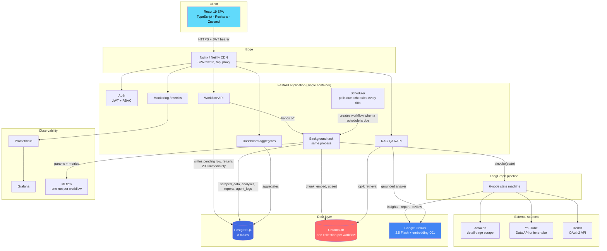
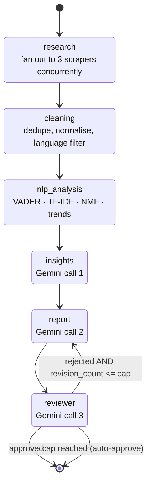
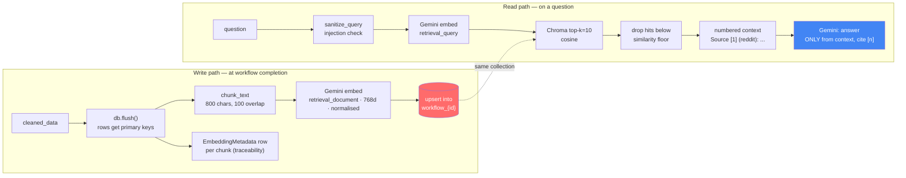
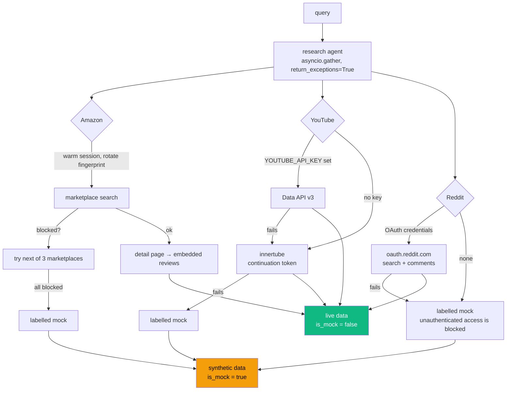

# AgentFlow — Interview Study Guide

> A plain-English, code-grounded walkthrough of this repo. Everything below is traced to real files in
> `backend/` and `frontend/` — file paths are given so you can open the code mid-answer if asked.

**Repo shape at a glance:** ~7,200 lines of Python across `backend/app/` (8 API routers, 8 ORM models,
6 LangGraph agents, 3 scrapers plus a shared fetch toolkit, 4 NLP modules, 4 RAG modules) with ~1,600 lines
of tests (190 cases, all offline), and ~1,450 lines of React/TypeScript across `frontend/src/` (7 pages,
5 components, 1 API client). CI runs backend tests, a frontend typecheck and build, and a Docker build on
every push.

---

## 1. One-Line Elevator Pitch

**AgentFlow is a web app where you type in a product or brand name, and a pipeline of six AI agents goes out,
collects public opinion about it from Amazon, YouTube and Reddit, analyses the sentiment, and writes you a
McKinsey-style market intelligence report you can download as a PDF.**

If they want ten more seconds: *"It's full-stack — React frontend, FastAPI backend, LangGraph orchestrating
the agents, Google Gemini doing the writing, Postgres storing everything, deployed on Netlify and Render."*

---

## 2. Problem & Motivation

### The problem in plain terms

Say you're a product manager at a consumer-goods company, or a founder about to launch something. You want to
know: **what do people actually think about this product, and who else is in this market?**

Today that means a human analyst:

1. Googling the product and opening 40 tabs
2. Scrolling Amazon reviews, Reddit threads and YouTube comment sections
3. Mentally averaging out "is the vibe positive or negative?"
4. Writing a slide deck about competitors, risks and recommendations

That's **days of work**, it's **inconsistent** (two analysts produce two different answers), and it **goes
stale** the moment a new competitor launches.

### What AgentFlow does about it

It automates that whole loop into a single text box. You type `Boat Airdopes 141`, tick which sources you
want, and hit go. About a minute later there's a structured 14-section report waiting: executive summary,
competitor analysis, SWOT, consumer sentiment, risks, recommendations, future outlook.

### Why this is genuinely useful

- **Speed** — days of analyst work compressed into roughly a minute.
- **Consistency** — every report follows the same schema, so you can compare two products side by side.
- **Repeatability** — the `scheduled_tasks` table exists so a query can re-run daily/weekly and you can watch
  sentiment move over time.
- **Auditability** — this is the one that matters. Every agent's inputs, outputs and runtime go into the
  `agent_logs` table, and every scraped comment goes into `scraped_data`. So when the report claims
  *"consumers complain about battery life"*, you can go back and find the rows behind that claim. An LLM
  answer you can't audit isn't worth much in a business setting.

### Being honest about scope (say this before they find it)

This is a **working MVP, not a production data product.** Volunteering that converts a weakness into a
credibility signal:

- **Amazon and YouTube collect live data with no credentials.** YouTube uses innertube (its own front-end's
  JSON API) when no Data API key is set; Amazon warms a browser-like session and reads reviews off the product
  detail page. **Reddit is the exception** — it blocks all unauthenticated access, so without OAuth credentials
  it returns synthetic data, always flagged `metadata.is_mock`.
- **NLP is real but deliberately lightweight**: VADER for sentiment, TF-IDF for keywords, NMF for topics. These
  give genuine linguistic analysis for a few megabytes, so the `OOM prevention` trade-off that removed the
  transformer models no longer costs anything analytically.
- **RAG works end to end** (details in §5.3): each workflow's corpus is chunked, embedded with
  `gemini-embedding-001`, and upserted into its own Chroma collection at workflow completion.

- **Scheduling runs.** `ScheduledTask` rows are executed by a poller started from the FastAPI lifespan, not
  just stored.
- **What is still honestly missing:** background work runs in-process (a restart loses in-flight workflows),
  ChromaDB's disk is ephemeral on a free tier, and the JWT lives in `localStorage`. Those are named in §5.5
  and Q14 with the fixes I would make.

The architecture is real, the seams are in the right places, and the intelligence at those seams is real too.
**Know exactly where the remaining limits are** — that's the difference between someone who built a thing and
someone who pasted a thing.

---

## 3. Full Tech Stack Breakdown

For each: *what it does here* → *why it beat the obvious alternative* → *what it cost me*.

### 3.1 Backend Core

#### **Python 3.11**

- **What it does here:** the entire backend — API, agents, scrapers, NLP, report generation.
- **Why Python:** every AI library I needed (LangGraph, LangChain, the Gemini SDK, ChromaDB, scikit-learn) is
  Python-first. Other ecosystems have ports; they lag. Choosing anything else meant fighting the ecosystem on
  day one.
- **Trade-off:** Python is slow at CPU-bound work and has a GIL. It doesn't hurt here because this app is
  almost entirely **I/O-bound** — waiting on HTTP calls to Gemini, YouTube and the database. Async Python is a
  great fit for waiting; it'd be a bad fit for heavy numeric work in-process.

#### **FastAPI** — `backend/app/main.py`

- **What it does here:** the HTTP layer. Mounts 8 routers (`auth`, `workflows`, `reports`, `dashboard`, `rag`,
  `schedules`, `monitoring`, `admin`), two middlewares, CORS, a global error handler, and a Prometheus
  `/metrics` endpoint. Its dependency-injection system is how a DB session and the current user reach every route.
- **Why not Flask:** Flask is synchronous by default. My workflow makes three Gemini calls plus several scrape
  calls — all *waiting on the network*. With sync Flask each waiting request occupies a worker thread.
  FastAPI's `async def` lets one process hold hundreds of waiting requests. Getting that from Flask means
  bolting on gevent or Quart — at which point I've rebuilt FastAPI, badly.
- **Why not Django:** Django is batteries-included around its own ORM, admin, templates and MVC conventions. I
  have no server-rendered pages (React SPA is separate) and I want SQLAlchemy, not Django ORM. I'd import a
  large framework and use ~15% of it.
- **What FastAPI specifically buys me:** Pydantic type hints do triple duty — runtime validation, editor
  autocomplete, **and** auto-generated OpenAPI docs at `/docs`. One `WorkflowCreate` model gives all three.
- **Trade-off:** async is genuinely easy to get wrong. One blocking call inside an `async def` freezes the
  event loop for *every* user. That's exactly why `backend/app/rag/vectorstore.py` wraps every ChromaDB call in
  `asyncio.to_thread(...)` — Chroma's client is synchronous, so calling it directly would stall the server.
  That's a real bug class you have to actively think about; Flask never makes you think about it.

#### **SQLAlchemy 2.0 (async) + asyncpg** — `backend/app/database.py`, `backend/app/models/`

- **What it does here:** ORM and connection pooling. Models use the modern 2.0 typed style (`Mapped[str]` /
  `mapped_column`), so the type checker knows a column is `str | None` rather than `Any`.
- **Why an ORM at all:** eight related tables with UUID foreign keys and JSON columns. Hand-writing that SQL
  and mapping rows to objects is a lot of error-prone code. It also means **the same code runs on SQLite
  locally and Postgres in production**.
- **Why asyncpg over psycopg2:** psycopg2 is synchronous — using it in an async app reintroduces the blocking
  problem above. asyncpg is a native async Postgres driver and the fastest one in Python.
- **A detail worth mentioning out loud:** the pool config is conditional.

  ```python
  engine_kwargs = {"echo": settings.DEBUG}
  if "sqlite" not in _db_url:
      engine_kwargs.update({
          "pool_size": settings.DB_POOL_SIZE,          # 5
          "max_overflow": settings.DB_MAX_OVERFLOW,    # 5
          "pool_pre_ping": True,
          "pool_recycle": settings.DB_POOL_RECYCLE_SECONDS,  # 240, below Neon's 5-min scale-to-zero
          "connect_args": _connect_args,
      })
  ```

  SQLite's async driver rejects `QueuePool` sizing arguments, so those only apply to server-backed databases.
  `pool_pre_ping=True` matters specifically for a serverless Postgres like Neon, which drops idle connections —
  pre-ping tests a pooled connection before handing it out instead of blowing up on a dead socket. When
  `DATABASE_URL` points at Neon's **pooled** endpoint (`-pooler` in the host, i.e. PgBouncer in transaction
  mode), `normalize_db_url` also disables asyncpg's prepared-statement caches, which PgBouncer breaks.
- **Trade-off:** async SQLAlchemy has sharp edges. Lazy-loading a relationship in async context raises rather
  than silently querying. The relationships used to be `lazy="selectin"` to dodge that, and it was the single
  biggest page-load cost: loading a `User` (every authenticated request) eagerly loaded all their workflows,
  and every workflow all of its scraped rows. That was 7 extra queries per request, growing with history
  (about 300 ms at 60 workflows, measured in `docs/PERF_BASELINE.md`). Every relationship is now
  `lazy="raise_on_sql"`: nothing loads implicitly, an accidental access fails loudly in tests, and queries
  select exactly what they need.

#### **Pydantic v2 + pydantic-settings** — `backend/app/schemas/`, `backend/app/config.py`

- **What it does here:** two jobs. (1) Request/response validation — `WorkflowCreate` rejects an empty or
  500+ character query *before* any of my code runs. (2) Config — `Settings(BaseSettings)` loads every env var
  with a typed default, so a missing variable is a startup problem, not a 3am `KeyError`.
- **Why not manual validation / `os.getenv`:** manual validation drifts from the docs immediately. Pydantic
  models *are* the docs — FastAPI generates the OpenAPI schema from them.
- **Trade-off:** v2 error messages are dense, and the v1→v2 API change (`ConfigDict` replacing `class Config`)
  means older tutorials actively mislead you.

#### **Alembic**

- **What it does here:** configured (`alembic.ini`, `alembic/env.py`) and wired to `make migrate`.
- **Status:** there is an initial migration covering all 8 tables, verified to apply and downgrade cleanly, with
  dialect-neutral types (`sa.Uuid()`) so the same migration works on SQLite locally and PostgreSQL in
  production. `alembic upgrade head` is the documented setup step.
- **Why it matters, and why it was worth doing:** before this, `init_db()` ran `Base.metadata.create_all` at
  startup. That creates *missing* tables but **never alters an existing one** — so renaming a column in
  production silently does nothing and surfaces later as a confusing runtime error. `create_all` is fine for a
  first deploy and actively dangerous for the second.

### 3.2 AI / Agent Layer

#### **LangGraph** — `backend/app/agents/graph.py`, `state.py`

- **What it does here:** defines the pipeline as a **state machine**. Six nodes
  (`research → cleaning → nlp_analysis → insights → report → reviewer`), one shared typed state object
  (`AgentState`), and one **conditional edge** out of the reviewer that either ends the run or loops back to
  the report node.
- **Why not just chain the functions myself?** For a purely linear pipeline, plain function calls would be
  fine — and I'd say that rather than oversell. LangGraph earns its place at exactly one line:

  ```python
  workflow.add_conditional_edges('reviewer', should_continue, {'end': END, 'report': 'report'})
  ```

  That's a **cycle** — the reviewer can reject the report and send control *backwards*. Hand-rolled, a cycle
  means a `while` loop with manual state threading, manual loop guards, and no structure a reader can see at a
  glance. With LangGraph the graph *is* the documentation, and streaming/checkpointing/visualisation are
  available later without a rewrite.
- **Why not CrewAI:** CrewAI models agents as role-playing coworkers that delegate and choose their own order.
  Great for open-ended tasks, wrong for mine — I need a **deterministic, auditable order** (you cannot clean
  data you haven't scraped). CrewAI gives away control I specifically want.
- **Why not AutoGen:** AutoGen is built around multi-agent *conversation* — agents message each other until
  they converge. Unpredictable token spend and no guaranteed termination. My pipeline has one fixed path and
  one bounded loop.
- **Why not LangChain's LCEL chains:** LCEL pipes form a DAG. Clean for linear flows, but a DAG cannot express
  a cycle — and my reviewer loop is a cycle. LangGraph exists precisely because LangChain couldn't do this.
- **Trade-off:** an extra dependency with its own concepts (state reducers, checkpointers, compiled graphs) for
  a pipeline that's 90% linear. And I'm not using its best feature — **no checkpointer is configured**, so if
  the process dies mid-workflow the run is simply lost. Adding one would let a crashed workflow resume from the
  last completed node; it's the single biggest upgrade available here.

#### **Google Gemini 2.5 Flash** — `insight_agent.py`, `report_agent.py`, `reviewer_agent.py`, `rag/retriever.py`

- **What it does here:** four jobs, three of which run in every workflow — extracting insights from the NLP
  output, writing the 14-section report, and reviewing that report for quality. It's also the answer generator
  for the RAG endpoint.
- **Why Gemini over OpenAI or Claude:** three concrete reasons, in order of how much they actually mattered.
  1. **A genuinely usable free tier.** This is a student project. I run the full pipeline dozens of times a day
     while debugging, and each run is 3 LLM calls. On pay-per-token that iteration loop costs real money.
  2. **Native JSON mode.** Setting `generation_config={"response_mime_type": "application/json"}` returns
     parseable JSON instead of prose in markdown fences. My whole pipeline passes structured dicts between
     agents, so this killed a class of parsing bugs. (I still keep a defensive `extract_json()` helper.)
  3. **A huge context window.** The report prompt is long — 14 section descriptions plus a full JSON schema
     plus pipeline context. Flash swallows it without me compressing anything.
- **Why Flash and not Pro:** Flash is the cheap, fast tier. I call it 3× per workflow with a user waiting. For
  structured summarisation, Flash is more than adequate; Pro costs latency for a difference nobody would notice.
- **Trade-off, stated honestly:** for long-form analytical writing, Claude and GPT-4-class models are better
  writers — I traded output polish for cost and iteration speed. Also **vendor coupling**: I call
  `google.generativeai` directly rather than going through a provider abstraction, so switching means editing
  four files. That was deliberate (direct SDK access to JSON mode and `generate_content_async`, no abstraction
  in the way) but it is a real coupling I'd have to pay down for multi-provider failover.

#### **ChromaDB** — `backend/app/rag/vectorstore.py`

- **What it does here:** the vector store for the RAG endpoint, running as an **embedded, on-disk database**
  via `chromadb.PersistentClient(path=CHROMA_PERSIST_DIR)` — no separate server, no network hop. Collections
  are namespaced per workflow: `workflow_{id}`, created in **cosine space** so similarity reads as
  `1 - distance`. Writes use `upsert` with deterministic chunk ids, which makes re-indexing idempotent.
- **Why not Pinecone:** hosted, paid, network service. An account, an API key, latency on every query and a
  bill — enormous overkill for a corpus of a few thousand short comments per workflow.
- **Why not FAISS:** FAISS is a *library*, not a database — a fast index and nothing else. I'd have to build
  persistence, metadata filtering and document storage myself. Chroma gives all three out of the box, and my
  corpora are far too small for FAISS's speed advantage to be visible.
- **Why not Weaviate:** a full server with a schema system, GraphQL and a Docker deployment. Right at scale,
  wrong for a free-tier MVP.
- **Trade-off — the important one:** "embedded and on-disk" means the vectors live on **one server instance's
  local filesystem**. On Render's free tier that filesystem is **ephemeral** — wiped on every redeploy — and it
  can't be shared across instances. Chroma is right for *now* and is explicitly the first thing that breaks
  when this scales. The natural upgrade is **pgvector on the Postgres I already have**, which collapses two
  datastores into one and makes the vectors durable.

#### **NLP stack: VADER + scikit-learn + langdetect** — `backend/app/nlp/`

- **VADER for sentiment.** A lexicon-and-rules analyser built for social and review text. It handles negation
  ("not good" → negative), intensifiers, contrast ("good but pricey"), emphasis and emoji, and returns a
  compound score in [-1, 1] that averages meaningfully across a corpus.
- **Why not a transformer:** DistilBERT-SST2 is ~250MB resident plus torch, against a 512MB free-tier cap. VADER
  is a few megabytes. On product-review text the accuracy gap is real but modest, and a deployed app beats a
  more accurate one that OOMs on boot. If I had the RAM I would fine-tune DistilBERT, mainly for sarcasm, which
  no lexicon catches.
- **TF-IDF for keywords.** Raw counts surface words common everywhere ("product", "phone"); TF-IDF surfaces what
  makes *this* corpus distinctive. Bigrams matter because the useful phrases in reviews are two words —
  "battery life", "build quality".
- **NMF for topics.** Non-negativity makes each topic read as an additive set of terms rather than a mix of
  positive and negative contributions, which is what makes it interpretable. Chosen over LDA because the corpus
  is short, noisy user text, where LDA's document-length assumptions produce mush.
- **langdetect for language filtering**, seeded so the same text always classifies the same way — otherwise a
  re-run silently produces a different corpus.

#### **Scraping toolkit** — `backend/app/scrapers/web.py`

- **What it does here:** shared fetch primitives so the three scrapers differ only in what they *parse*, not in
  how they fetch — rotating browser fingerprints, `Sec-Fetch-*` headers, a brace-balanced JSON extractor for
  reading state out of single-page apps, and a recursive key search for walking deeply nested API payloads.
- **One detail worth mentioning:** `Accept-Encoding` only advertises brotli when the decoder is actually
  installed. Claiming `br` without it makes sites return bodies that arrive as undecodable bytes — a silent
  failure that looks like "the page has no data in it". That cost me a debugging session on YouTube.

#### **APScheduler** — `backend/app/core/scheduler.py`

- **What it does here:** runs due `ScheduledTask` rows. Started from the FastAPI lifespan, it polls every 60
  seconds rather than registering one job per schedule.
- **Why polling over per-schedule jobs:** the database stays the single source of truth. Schedules survive a
  restart with no re-registration, and a schedule created on one instance is honoured by whichever instance
  polls next. Per-schedule registration would need a rehydration step on boot and would break the moment there
  were two instances.
- **A subtlety:** a schedule whose launch *fails* still has its `next_run_at` advanced. Otherwise one broken
  schedule fires on every single poll forever.

#### **LangChain**

- **What it does here:** honestly, very little. It's in `requirements.txt` as a LangGraph dependency; my agents
  call the Gemini SDK directly. Better to say that plainly than claim a deep integration — an interviewer who
  greps the repo finds out in thirty seconds.

### 3.3 Data Layer

#### **PostgreSQL (Neon in production, SQLite locally)**

- **What it does here:** the system of record — users, workflows, scraped rows, analytics, reports, agent logs,
  scheduled tasks. Production sets `DATABASE_URL` to a **Neon** serverless Postgres string
  (`postgresql+asyncpg://...neon.tech/neondb?ssl=require`); the code default is
  `sqlite+aiosqlite:///./agentflow.db` for zero-setup local dev.
- **Why relational and not MongoDB:** the data is *aggressively* relational. A workflow has many scraped rows,
  many analytics rows, many agent logs, and produces a report; all of it belongs to a user. Almost every
  dashboard query is a **join plus an aggregate**:

  ```python
  select(func.avg(ScrapedData.sentiment_score))
      .join(Workflow, ScrapedData.workflow_id == Workflow.id)
      .where(Workflow.user_id == user_id)
  ```

  That's what SQL is for. In Mongo I'd either duplicate user data into every document or do the join in
  application code. I also get real foreign keys and transactional integrity — when the background task writes
  50 scraped rows, 4 analytics rows, 1 report and 6 agent logs, they commit **atomically or not at all**.
- **"But your LLM output is unstructured JSON!"** — that's the neat part. Postgres has `JSON`/`JSONB` columns
  and I use them heavily (`analytics.metric_data`, `reports.recommendations`, `workflows.agent_states`). I get
  relational integrity where the shape is fixed *and* schemaless flexibility where the LLM's output shape
  isn't. That's why "Postgres or Mongo?" usually resolves to Postgres.
- **Why Neon specifically:** serverless Postgres with a real free tier, scale-to-zero and built-in pooling —
  managed Postgres without paying for an always-on instance.
- **Trade-off:** scale-to-zero means a **cold start** on the first query after idle. Serverless Postgres also
  caps concurrent connections tightly, so the pool is kept at 5 + 5 and the code supports Neon's pooled
  endpoint (PgBouncer). `pool_pre_ping=True` survives dropped idle connections. Measured, the Neon wake-up
  costs under 0.1 s; the cold start that hurts is Render's (~52 s).
- **The SQLite/Postgres split trade-off:** contributors run the project with zero setup, but I'm testing against
  a different engine than I deploy to. SQLite is far more permissive about types and concurrency, so "works
  locally, fails in prod" is a real accepted risk.

### 3.4 Frontend

#### **React 19 + TypeScript** — `frontend/src/`

- **What it does here:** a 7-page SPA — Dashboard, Workflows, Reports, Users, Settings, Login, Signup — with a
  route guard (`ProtectedRoute` in `App.tsx`) and auth state in a Context (`context/AuthContext.tsx`).
- **Why React:** largest component ecosystem, and Recharts (my charting library) is React-native.
- **Why TypeScript:** the API returns nested JSON. TS catches `report.executive_summary` typos at compile time
  instead of rendering `undefined` to a user.
- **Trade-off, honestly:** several components still use `any` for API responses (`useState<any[]>`), so I'm not
  extracting full value from TS. Generating types from the FastAPI OpenAPI schema would close that properly and
  keep frontend types in lockstep with backend models.

#### **Vite**

- **What it does here:** dev server and production bundler. Its dev proxy is a small but important detail:

  ```ts
  server: { proxy: { '/api': 'http://localhost:8000' } }
  ```

  In development the frontend calls `/api/...` on its own origin and Vite forwards it, so **CORS never enters
  the picture locally**.
- **Why not Create React App:** deprecated, and its Webpack dev server is slow to start and slow to reload.
  Vite serves native ES modules in dev — startup is near-instant regardless of project size.
- **Trade-off:** dev (unbundled ESM) and prod (Rollup bundle) run different code paths, so a bug can in
  principle appear only in the production build.

#### **Tailwind v4, React Router v6, Axios, Recharts, lucide-react**

- **Tailwind v4** via the `@tailwindcss/vite` plugin, plus a small custom "claymorphism" design system
  (`clay-card`, `clay-button`, `clay-input` in `index.css`). Trade-off: JSX gets visually noisy.
- **React Router v6** — client-side routing. This is why `netlify.toml` needs a catch-all rewrite (§3.5).
- **Axios over `fetch`** — for **interceptors**, which is the entire reason. One request interceptor attaches
  the JWT to every call; one response interceptor catches any `401`, clears localStorage and redirects to
  `/login`. With `fetch` that's per-call boilerplate everywhere. See `frontend/src/api/client.ts`.
- **Recharts** — the dashboard's area chart and sentiment pie. Declarative React components rather than D3's
  imperative DOM manipulation. Trade-off: much less flexible than raw D3 for anything unusual.
- **Note:** `zustand` is in `package.json` but **unused** — auth state lives in React Context. Dead dependency;
  I'd remove it. Better to say that than claim I used it.

### 3.5 DevOps & Deployment

#### **Netlify (frontend) + Render (backend)**

- **What they do here:** Netlify builds `frontend/` (`base = "frontend"`, `npm run build`, publish `dist`) and
  serves the static bundle from a CDN. Render runs the FastAPI container (`uvicorn app.main:app`) with
  `DATABASE_URL` pointed at Neon.
- **The one Netlify config that matters:**

  ```toml
  [[redirects]]
    from = "/*"
    to = "/index.html"
    status = 200
  ```

  Without it, a hard refresh on `/reports` returns 404 — the static host looks for a file called `reports` that
  doesn't exist. The rewrite serves `index.html` for every path and lets React Router resolve it client-side.
  Classic SPA-deployment gotcha, and a good thing to be able to explain.
- **Why split hosting instead of one platform (Vercel/Railway):**
  1. **They're different kinds of workload.** The frontend is static files that want a global CDN. The backend
     is a long-lived Python process running minute-long background jobs. Netlify is excellent at the first and
     cannot do the second; Render runs a real container.
  2. **Vercel's Python support is serverless functions** — the wrong shape entirely. Short execution limits, no
     persistent process. My workflow runs for ~60 seconds *after* the HTTP response has already been sent via
     `BackgroundTasks`. That pattern **requires** a process that stays alive.
  3. **Independent deploys.** A CSS tweak redeploys the frontend in ~30 seconds without touching the API.
  4. Both have free tiers that fit a student project.
- **Trade-off — real:** two dashboards, two sets of env vars, two deploy pipelines, and because they're on
  different origins **CORS becomes mandatory in production** (it doesn't exist in dev, thanks to the Vite
  proxy). This used to be `allow_origins=["*"]` together with `allow_credentials=True` — a combination browsers
  **reject outright**, so it was simultaneously insecure in intent and broken in practice. Origins now come from
  a `CORS_ORIGINS` setting, and credentials are disabled automatically if a wildcard is configured, so the two
  can never be inconsistent again.

#### **Docker + Docker Compose** — `docker-compose.yml`, both `Dockerfile`s

- **What it does here:** the full local stack — Postgres 16, backend, frontend, ChromaDB, MLflow, Prometheus,
  Grafana — in one `docker-compose up`. Both Dockerfiles are **multi-stage** (build deps in stage 1, only
  runtime artifacts in stage 2) and both drop to a **non-root user**: standard container hygiene.
- **Why:** "clone the repo and run one command" is worth a lot, and it keeps the observability stack available
  locally without cluttering the deployed app.
- **Trade-off:** the deployed production setup is **not** this Compose file — production is
  Netlify + Render + Neon. Compose is a dev/demo convenience, with config-drift risk between the two.

#### **Prometheus + Grafana + structlog + MLflow**

- **Prometheus:** `PrometheusMiddleware` (`core/middleware.py`) records `http_requests_total` (Counter,
  labelled method/endpoint/status) and `http_request_duration_seconds` (Histogram), exposed at `/metrics`.
  **A bug worth telling:** `prometheus.yml` scraped `/api/monitoring/metrics` while `main.py` mounted the
  metrics app at `/metrics`. Everything *looked* wired — middleware recording, endpoint serving, Prometheus
  configured — but the target 404'd, so in the Compose stack Prometheus showed DOWN and Grafana had no data. A
  one-line fix, and a good example of why you verify that observability actually observes rather than assuming
  it does because the pieces exist.
- **structlog:** structured **JSON** logs rather than free text, so every line carries `workflow_id`, `agent`,
  `duration` as queryable fields. Trade-off: unpleasant to read raw in a terminal.
- **MLflow:** `core/tracking.py` logs **one run per workflow** — query and sources as params; live-data ratio,
  per-agent latency, sentiment, chunks indexed, revision count and report quality as metrics. That makes runs
  comparable over time, which is the point: `live_data_ratio` dropping is a signal a source started blocking
  you. Tracking is best-effort and swallows its own errors, because a reporting sink must never fail the
  workflow it is reporting on. Defaults to a local `./mlruns` file store, so it works with no server running.

#### **GitHub Actions** — `.github/workflows/ci.yml`

- **What it does here:** three jobs on every push and PR — backend `pytest`, frontend typecheck + build, and a
  Docker build with `docker compose config` validation.
- **The design decision that matters:** the test suite is **deliberately offline**. No API keys are set in CI,
  scrapers are tested against HTML fixtures, and every credential-dependent path is exercised through its
  fallback. So a test that silently needs a key fails the build rather than passing on a developer machine and
  breaking elsewhere. 190 tests run in about 8 seconds.
- **A bug CI caught immediately:** `docker compose config` failed with `env file .env not found`. The Compose
  services declare `env_file: .env`, which is gitignored — so `docker compose up` had never worked from a clean
  clone, only on machines that already had a local `.env`. CI now generates it from `.env.example`, which
  doubles as an assertion that the example file stays complete enough to boot the stack.

#### **JWT (python-jose) + bcrypt**

- **What it does here:** `POST /api/auth/login` verifies a bcrypt hash and returns an HS256 JWT whose `sub` is
  the user's UUID, expiring in 30 minutes. `get_current_user` decodes it, loads the user, checks `is_active`.
  `require_role("admin")` is a dependency factory for role-gated routes.
- **bcrypt and the event loop:** bcrypt is deliberately slow CPU work: 240 ms at cost 12 on a laptop, **1.7 s on
  Render's free CPU**. Called inline from an `async def` route it froze the event loop, so every other user
  waited behind a login. It now runs in `asyncio.to_thread` (bcrypt releases the GIL). The cost is
  `BCRYPT_ROUNDS=11` (halves it, still above OWASP's minimum of 10), and stored hashes migrate to the
  configured cost on the user's next successful login. Unknown emails run a dummy bcrypt check, because
  before that "no such user" answered in 0.4 s and "wrong password" in 2.1 s, which let anyone probe
  which emails have accounts.
- **Why JWT over server-side sessions:** the API is stateless and the frontend is on a different origin. A JWT
  travels in an `Authorization` header and needs no shared session store, so the backend can scale horizontally
  without sticky sessions or Redis.
- **Trade-off, honestly:** the token lives in `localStorage`, which is **readable by any JavaScript on the
  page** — XSS-exposed in a way an `HttpOnly` cookie wouldn't be. And JWTs **can't be revoked** before expiry;
  the 30-minute lifetime is the mitigation, and there's no refresh flow, so users get logged out every
  30 minutes. Both are known, deliberate MVP trade-offs.

---

## 4. Architecture & System Diagrams

Four views, because no single diagram answers every question. Start with the system diagram; drop into the
others when an interviewer drills in.

### 4.1 System architecture



**How to narrate this in 30 seconds:**

> "One FastAPI service. Starting a research job writes a `pending` row, hands the work to a background task,
> and returns immediately — the HTTP request never waits on a 60-second job. The background task runs a
> LangGraph state machine: agents collect from Amazon, YouTube and Reddit, clean and analyse the text, then
> call Gemini to generate insights, write the report and review it. Results land in Postgres, and the same
> corpus is embedded into that workflow's own ChromaDB collection so you can ask follow-up questions about it
> afterwards. The frontend polls until the status flips to `completed`."

### 4.2 The LangGraph state machine

The one structural reason LangGraph is here rather than six function calls: the reviewer edge points
*backwards*.



Every node reads and writes one shared `AgentState` TypedDict — the blackboard pattern, not message passing.
The cycle is bounded twice over: the reviewer node force-approves at `MAX_REPORT_REVISIONS`, and the graph
router enforces the same cap independently, so malformed reviewer JSON still terminates.

### 4.3 The RAG pipeline

Two halves that run at different times. The write half is what makes the read half possible — and it was the
piece originally missing.



Chunk ids are `{scraped_id}:{index}`, which makes re-indexing idempotent — the same chunk overwrites rather
than duplicating. If retrieval succeeds but generation is rate-limited, the endpoint returns the retrieved
context rather than nothing: the expensive half already succeeded.

### 4.4 Data collection strategy

Each source degrades down its own chain. Nothing is silently synthetic — every item carries
`metadata.is_mock`.



Setting `ALLOW_MOCK_DATA=false` turns every one of those fallback arrows into a raised exception instead — for
when you would rather a run fail than quietly produce a report from templates.

---

## 5. System Design Deep Dive

### 5.1 Request Lifecycle: one real user action, end to end

Tracing **"user starts a research workflow on `Boat Airdopes 141`"** through every layer. This is the answer
to "walk me through your system" — it touches auth, validation, async work, the agent graph, the LLM and
persistence in one story.

#### Phase 1 — Browser (~0 ms)

1. User opens the **Workflows** page, clicks *New Research*, and `NewWorkflowModal.tsx` renders a form with a
   query field and three source checkboxes (all on by default).
2. On submit, the component converts the checkbox object into an array and calls
   `createWorkflow({ query, sources })`.
3. `frontend/src/api/client.ts` fires `POST /api/workflows/`. The **request interceptor** reads the JWT from
   `localStorage` and sets `Authorization: Bearer <token>`. The base URL is `VITE_API_URL || '/api'` — in dev
   Vite proxies `/api` to `localhost:8000`; in production it's the Render URL.

#### Phase 2 — FastAPI middleware & validation (~1–5 ms)

4. **CORS middleware** — in production the request is cross-origin (Netlify → Render), so this must pass.
5. **`RequestLoggingMiddleware`** starts a timer; **`PrometheusMiddleware`** will increment
   `http_requests_total` and observe `http_request_duration_seconds` on the way out.
6. **Pydantic** parses the body into `WorkflowCreate`. Its `field_validator` strips whitespace and rejects
   anything under 2 or over 500 characters — a `422` before any of my code runs.

#### Phase 3 — Auth & sanitisation (~5–20 ms)

7. `Depends(get_current_user)` → `verify_token()` decodes the HS256 JWT (a bad or expired token is `401`),
   pulls `sub` as a UUID, `SELECT`s that user, and checks `is_active`.
8. `Depends(get_db)` opens an async session from the pool; the dependency commits on success, rolls back on
   exception, and always closes.
9. **`sanitize_query()`** (`core/sanitizer.py`) runs before anything else touches the query: truncate to
   500 chars / 60 words, strip prompt-breaking sequences (`"""`, `{{`, `${`), then test ~20 regexes for
   prompt-injection patterns (`ignore previous instructions`, `system prompt:`, `[INST]`, `jailbreak`, …).
   A match raises `ValueError` → **HTTP 400**. Only the sanitised string continues.

#### Phase 4 — Write + hand off (~10 ms)

10. `workflow_service.create_workflow()` inserts a row into `workflows` with `status="pending"` and commits.
11. `background_tasks.add_task(execute_workflow_task, ...)` **queues** the real work. Nothing runs yet.
12. The route returns the workflow object. **Total latency: well under a second**, even though the actual job
    takes ~60. Starlette runs the background task *after* the response is flushed.
13. The modal closes and `Workflows.tsx` re-fetches. Its `useEffect` also runs `setInterval(loadWorkflows,
    10000)` — a 10-second poll.

#### Phase 5 — Background worker (~30–90 s) — `workers/tasks.py`

14. The task creates its **own engine and session factory**. It cannot borrow the request's session — that one
    was closed when the response was sent.
15. `UPDATE workflows SET status='running', started_at=now()`. The next poll shows a pulsing "running" icon.
16. `run_workflow(query, sources, workflow_id)` builds the initial `AgentState` (18 keys, all initialised) and
    calls `graph.ainvoke(initial_state)`.

#### Phase 6 — The agent graph (the bulk of the time)

17. **`research`** — builds a list of scraper coroutines for the selected sources and runs them concurrently
    with `asyncio.gather(*scrapers, return_exceptions=True)`. Concurrency matters: three sources in parallel
    take as long as the slowest one, not the sum. `return_exceptions=True` means a Reddit failure doesn't kill
    the YouTube results — failures are appended to `state["errors"]` and the run continues.
18. **`cleaning`** — strips URLs and special characters, drops anything under 10 characters, deduplicates by
    hashing lowercased content, and applies a crude English filter. Produces `cleaned_data`.
19. **`nlp_analysis`** — VADER sentiment per item, TF-IDF keywords with per-keyword sentiment, NMF topics, and
    a trend direction computed by comparing the positive ratio of the first half of the corpus against the
    second half (`IMPROVING` / `DECLINING` / `STABLE`).
20. **`insights`** — **Gemini call #1.** Sends topics + keywords + trends, asks for JSON with `insights`,
    `competitor_analysis` and `pain_points`.
21. **`report`** — **Gemini call #2**, the big one. Before prompting, it *filters out fallback-looking context*
    (if the insight summary starts with "Initial analysis of…" or competitors read "Competitor A", that context
    is dropped rather than fed forward as if it were data). Then it sends a long McKinsey-analyst prompt with a
    strict 14-section JSON schema.
22. **`reviewer`** — **Gemini call #3.** Asks for `{approved, feedback, quality_score}`.
23. The conditional edge reads `review_feedback.approved`: `True` → `END`; `False` → back to `report`.
    `revision_count` force-approves at 2 so this can't loop forever.

#### Phase 7 — Persistence & display

24. Back in the worker, one transaction writes: every cleaned item → `scraped_data` (with its sentiment), four
    metric rows → `analytics`, one row → `reports` (with `full_report` as serialised JSON), one row per agent →
    `agent_logs` (with `execution_time_ms`), and finally `UPDATE workflows SET status, completed_at,
    result_summary, agent_states`.
25. The next 10-second poll returns `completed`. The **Reports** page lists it; *Download PDF* hits
    `GET /api/reports/{id}/export/pdf`, which builds a ReportLab PDF in memory and returns a `StreamingResponse`.
26. `engine.dispose()` in a `finally` block releases the worker's connections either way.

### 5.2 How the multi-agent orchestration actually works

#### The shared state — `agents/state.py`

Every node receives and returns **one `AgentState` TypedDict**. That's the whole communication mechanism:
agents don't call each other, don't message each other, and don't know each other exist. They read the keys
they need and write the keys they own.

```python
class AgentState(TypedDict):
    query: str;             workflow_id: str;      sources: List[str]
    raw_data: List[dict];   cleaned_data: List[dict]
    sentiment_results: List[dict]; topics: List[dict]; keywords: List[dict]; trends: dict
    insights: dict;         competitor_analysis: dict; pain_points: List[dict]
    report: dict;           review_feedback: dict
    status: str;            errors: List[str];     agent_logs: List[dict]
    current_agent: str;     revision_count: int
```

**Why this design is good:** it's a **blackboard pattern**. Adding a seventh agent means adding a node and a
key — no existing agent changes. Each node is independently testable: hand it a dict, assert on the dict it
returns, no mocking of other agents required. And because state is one object, the whole run is inspectable at
any point, which is what makes `agent_logs` possible.

**Why it's also a weakness worth naming:** the state is a single flat namespace with no ownership enforcement.
Nothing stops the report agent from overwriting `cleaned_data`. At larger scale I'd use LangGraph's
`Annotated` reducers to define per-key merge semantics.

#### The graph structure — `agents/graph.py`

```
       ┌──────────┐    ┌──────────┐    ┌──────────────┐    ┌──────────┐
START →│ research │ →  │ cleaning │ →  │ nlp_analysis │ →  │ insights │
       └──────────┘    └──────────┘    └──────────────┘    └──────────┘
                                                                 ↓
                                        ┌──────────┐        ┌──────────┐
                              END  ←····│ reviewer │  ←     │  report  │
                                        └──────────┘        └──────────┘
                                              ╎                   ↑
                                              └───── rejected ─────┘
```

Five plain edges plus one **conditional edge**:

```python
def should_continue(state: AgentState) -> str:
    if state.get('review_feedback', {}).get('approved', False):
        return 'end'
    return 'report'

workflow.add_conditional_edges('reviewer', should_continue, {'end': END, 'report': 'report'})
```

#### The six agent roles

| Agent | Role | LLM? | Reads | Writes |
|:--|:--|:--|:--|:--|
| **research** | Fan out to scrapers concurrently | No | `query`, `sources` | `raw_data`, `errors` |
| **cleaning** | Dedupe, normalise, language-filter | No | `raw_data` | `cleaned_data` |
| **nlp_analysis** | Sentiment, keywords, topics, trends | No | `cleaned_data` | `sentiment_results`, `keywords`, `topics`, `trends` |
| **insights** | Turn signals into insights, competitors, pain points | **Yes** | `topics`, `keywords`, `trends` | `insights`, `competitor_analysis`, `pain_points` |
| **report** | Write the 14-section report | **Yes** | insights, competitors, pain points, trends | `report` |
| **reviewer** | Quality-gate the report | **Yes** | `report` | `review_feedback`, `status` |

Every node also appends a dict to `agent_logs` with its name, status, input summary, output summary and
`execution_time_ms` — that's what makes the pipeline auditable after the fact.

#### The design principle behind the split

**Only three of six agents call an LLM.** Scraping, cleaning and counting are deterministic work — an LLM would
be slower, more expensive and *less* reliable at them. The LLM is used only where judgement is genuinely
required: interpreting signals, writing prose, and evaluating quality. Being able to articulate that boundary
is more valuable in an interview than the agent count.

#### The reviewer loop and its termination guard

```python
state["revision_count"] = revision_count + 1
if revision_count >= 2:
    state["review_feedback"] = {"approved": True, "feedback": "Auto-approved due to max revisions reached.",
                                "quality_score": 0.7}
    state["status"] = "completed"
    return state
```

Without that, a reviewer that keeps saying "not good enough" would loop forever, burning quota until the
process dies. **Any cyclic agent graph needs a hard termination guard** — that's the general lesson.

**The honest weakness in this loop:** `report_node` never reads `review_feedback`. So a "revision" re-runs the
*same prompt with the same inputs* — only LLM nondeterminism changes the output. A real revision loop would
inject the reviewer's critique into the retry prompt. It's a two-line fix and one of the best things I could
point at as "here's what I'd improve".

### 5.3 How RAG works here, end to end

**The intended design**, in four steps:

1. **Ingest** — after a workflow completes, each cleaned document is written to a ChromaDB collection named
   `workflow_{id}`, with metadata (`source`, date, ids) and a row in `embeddings_metadata` for traceability.
2. **Chunk** — the corpus is Reddit posts, YouTube comments and Amazon reviews: **already short**, typically
   under 500 characters. So **one document = one chunk**, and there is no splitter. That's a legitimate design
   decision, not an omission: chunking exists to fit long documents into a context window, and these are
   already the right size. If I ingested long-form articles I'd need a recursive splitter with overlap.
3. **Embed & store** — `EmbeddingGenerator` produces vectors; `VectorStore.add_documents()` upserts them into
   Chroma, wrapped in `asyncio.to_thread` because Chroma's client is synchronous.
4. **Retrieve & answer** — `RAGRetriever.query()` (`rag/retriever.py`) embeds the question, pulls the top 10
   documents, formats them as a **numbered source list**, and prompts Gemini with a strict instruction:

   ```
   Use ONLY the following context to answer the user's question.
   If the answer is not contained in the context, say so.
   Always cite your sources using the [number] format.
   ```

   It returns `{answer, sources, confidence}`, where `sources` carries the metadata for each retrieved chunk.
   Note the **empty-result short circuit**: if retrieval returns nothing, it replies *"I don't have enough
   context in the collected data to answer that"* instead of letting the model answer from memory. That's the
   single most important anti-hallucination guard in a RAG system.

**How ingestion works — and the three bugs that had to be fixed to get here:**

Indexing lives in `rag/indexer.py` and is called from `execute_workflow_task` after the scraped rows are
flushed (so chunk ids can be derived from real primary keys). Each item is chunked at 800 characters with 100
overlap, embedded, and upserted into `workflow_{id}` with an `EmbeddingMetadata` row per chunk.

Getting there meant fixing three things worth being able to explain:

- **Nothing called `add_documents()`.** `POST /api/rag/index` returned hardcoded success with a comment
  claiming indexing happened in `execute_workflow_task` — which only wrote to SQL. The collection was always
  empty, so every query hit the "not enough context" branch. Both are real now.
- **Embeddings were `[[0.0] * 384]`.** A local sentence-transformer had been stripped for `OOM prevention` and
  the placeholder returned zero vectors, which carry no semantic signal and make cosine similarity degenerate.
  The fix was a **hosted** embedding API — `gemini-embedding-001` — which removes the RAM constraint entirely.
  A subtlety: Gemini only returns unit-length vectors at its full 3072 dimensions, so the 768-d output must be
  **re-normalised** or cosine distance is meaningless.
- **A truthiness bug hid the fallback.** The retriever chose between vector and text search with
  `if not query_embedding[0]` — but `[0.0] * 384` is a *non-empty list*, which is truthy in Python regardless
  of contents. So it always passed the zero vector instead of falling back to text search. The guard now keys
  off whether embeddings are available at all, and `EmbeddingGenerator` returns `[]` rather than dummy vectors
  precisely so this cannot recur.

Explaining that Python-truthiness bug is a genuinely good interview moment: it is a one-line mistake that
silently disabled a fallback, and finding it requires understanding both the language semantics and the
vector-search behaviour it was masking.

### 5.4 Data model

Eight tables. UUID primary keys throughout, timezone-aware timestamps, JSON columns where the shape is fluid.

```
users ──┬── workflows ──┬── scraped_data        (raw comments + per-item sentiment)
        │               ├── analytics           (metric_type + metric_data JSON)
        │               ├── agent_logs          (one row per agent execution)
        │               ├── embeddings_metadata (chunk → Chroma collection mapping)
        │               └── reports
        ├── reports
        ├── agent_logs
        └── scheduled_tasks
```

| Table | What it holds | Why it exists as its own table |
|:--|:--|:--|
| `users` | email (unique, indexed), bcrypt hash, `full_name`, `role`, `is_active` | Auth + RBAC. First registered user becomes `admin`. |
| `workflows` | `query`, `status`, `sources` (JSON), `result_summary`, `agent_states` (JSON), `started_at`/`completed_at` | The **job record**. Separating `started_at` from `created_at` lets me measure queue delay vs execution time. |
| `scraped_data` | `source`, `content`, `metadata` (JSON), `sentiment_score`, `sentiment_label` | The **evidence layer** — what the report's claims are based on. Composite index on `(workflow_id, source)`. |
| `analytics` | `metric_type` + `metric_data` (JSON) | Key-value metrics table: `sentiment_distribution`, `keyword_frequency`, `trend_data`, `competitor_score`. New metric type = new row, **no migration**. |
| `reports` | `title`, `executive_summary`, four JSON analysis fields, `full_report` (serialised JSON), `status` | The **deliverable**. Common fields are queryable columns; the whole LLM payload is kept verbatim in `full_report` so nothing is lost. |
| `agent_logs` | `agent_name`, `status`, `input_data`, `output_data`, `execution_time_ms`, `error_message`, `tokens_used` | **Observability per agent.** This is how I answer "which agent is slow?" or "which one failed?". |
| `embeddings_metadata` | `collection_name`, `embedding_model`, `chunk_text`, `source_id` | Maps SQL rows to vectors in Chroma, so a retrieved chunk can be traced back to its origin row. |
| `scheduled_tasks` | `name`, `query`, `schedule_type`, `cron_expression`, `is_active`, `last_run_at`/`next_run_at` | Recurring analyses. |

**Design decisions worth defending:**

- **UUID primary keys, not auto-increment integers.** Three reasons: (1) IDs appear in URLs
  (`/api/workflows/{id}`), and sequential integers let anyone enumerate every workflow in the system;
  (2) the background worker can generate an ID without a round-trip to the database; (3) they merge cleanly
  across environments. **Cost:** 16 bytes instead of 4, and random UUIDs fragment B-tree indexes on insert. At
  this scale that's irrelevant; at billions of rows I'd use UUIDv7 (time-ordered) or ULIDs.
- **JSON columns for LLM output.** `analytics.metric_data` and `reports.recommendations` hold shapes that vary
  by model output and metric type. Normalising them would mean a schema migration every time an agent's output
  changes. **Cost:** you can't index or constrain inside a JSON blob as easily, and the DB can't validate it.
  It's the right call for *derived* data and the wrong call for the identity data in `users`.
- **Wide `reports` table with `full_report` alongside broken-out columns.** Deliberate duplication: the columns
  make the list view fast without deserialising a large blob, and `full_report` guarantees nothing the LLM
  produced is ever lost.
- **A quirk to be ready for:** `ScrapedData.metadata_` is a Python attribute mapped to a SQL column literally
  named `metadata` — because `metadata` is reserved on SQLAlchemy's declarative base. A tiny detail, but a good
  "I actually wrote this" signal.
- **Deletes cascade in application code, not the database.** `workflow_service.delete_workflow()` explicitly
  deletes from `embeddings_metadata`, `analytics`, `agent_logs`, `scraped_data` and `reports` before deleting
  the workflow. It works, but `ON DELETE CASCADE` at the FK level would be more robust — application-level
  cascade can be bypassed by any code path that forgets a table.

### 5.5 Scalability: what breaks first, and how I'd fix it

Ordered by what actually fails first, which is how a senior engineer would answer this.

**1. Background tasks run inside the API process — the #1 bottleneck.**
`BackgroundTasks` executes on the same event loop as the web server. So:
- CPU-ish agent work competes with serving HTTP requests.
- **A restart loses in-flight workflows.** Render redeploys, and a workflow stuck at `running` is stuck at
  `running` forever — there's no retry and no resume.
- Concurrency is bounded by one instance.

**Fix:** move execution to a real queue — **Celery/Arq/RQ + Redis** — with the API only enqueueing. That gives
retries, dead-letter handling, horizontal worker scaling, and workers that scale independently of web traffic.
Adding a LangGraph **checkpointer** on top would let a killed workflow resume at the last completed node.

**2. Gemini quotas — and there are now two of them.** Each workflow makes three *generation* calls, and the
free tier caps generation per day (20 on `gemini-2.5-flash`) as well as per minute. Separately, indexing makes
one *embedding* call per batch of 32 chunks against a 100-per-minute cap, so a ~170-chunk workflow can pause
mid-index. I hit both during testing, which is how I know the retry paths work.
**Fix:** a shared token-bucket limiter across workflows rather than each agent independently sleeping on a 429,
exponential backoff with jitter instead of a flat 60s, an embedding cache keyed by content hash so re-running an
overlapping corpus does not re-embed unchanged text, and combining the insight and report calls where quality
allows.

**3. ChromaDB on a local, ephemeral disk.** `PersistentClient` writes to the container filesystem. On Render's
free tier that's **wiped on redeploy**, and two instances would have two divergent stores.
**Fix:** run Chroma as a service (it's already in `docker-compose.yml`), or — better — move vectors to
**pgvector in the Postgres I already run**, which makes them durable, backed up, and shared, and removes a
whole datastore.

**4. Database connections.** The pool was `pool_size=20, max_overflow=10`, up to 30 connections *per
instance*. Serverless Postgres caps connections aggressively, so three instances would exhaust the limit.
**Done:** the pool is 5 + 5 (settings), recycled every 240 s, and the code supports Neon's pooled endpoint
(PgBouncer transaction mode needs asyncpg's statement caches off, which `normalize_db_url` does).

**5. Query patterns.** `get_overview_metrics` issues **six separate aggregate queries** on every dashboard
load, several joining `scraped_data` — which is the fastest-growing table. There are indexes on
`users.email` and `(workflow_id, source)`, but **none on `workflows.user_id` or `reports.user_id`**, which
every list query filters on.
**Fix:** add those indexes first (cheap, big win), then collapse the six queries into one, then cache the
overview in Redis with a short TTL or precompute it into a summary table.

**6. Polling.** Every open Workflows tab hits the API every 10 seconds — 6 requests/minute/tab, almost all
returning unchanged data.
**Fix:** **Server-Sent Events** (one-way server→client, which is exactly the shape of this problem, and far
simpler than WebSockets) or push notifications on completion.

**7. Schema evolution.** `create_all` at startup can't alter existing tables.
**Fix:** generate a real Alembic baseline migration and run `alembic upgrade head` on deploy.

**Rough capacity estimate to quote:** a single free-tier instance comfortably handles a handful of concurrent
workflows and dozens of dashboard users. The wall is the Gemini quota, then the single-process worker. Moving
to a queue plus paid LLM quota takes it into the low hundreds of concurrent workflows without touching the
architecture.

### 5.6 Error handling and failure modes

The design principle throughout: **degrade, don't die.** A market research report with partial data still has
value; a 500 error has none.

| Failure | What actually happens | Where |
|:--|:--|:--|
| **One scraper throws** | `asyncio.gather(..., return_exceptions=True)` collects it as a value; the exception is appended to `state["errors"]` and the other sources' data still flows through | `research_agent.py` |
| **A scrape request fails transiently** | `BaseScraper._execute_with_retry` retries up to 3× with exponential backoff (`backoff_factor ** attempt`) plus a rate-limit delay between requests | `scrapers/base.py` |
| **All retries exhausted / no API key / blocked** | Falls back to a **labelled** mock corpus of 30–50 items, every item flagged `metadata.is_mock`. `ALLOW_MOCK_DATA=false` makes this raise instead | `scrapers/*.py` |
| **Gemini rate-limits (429)** | Detected by string-matching `429` / `ResourceExhausted` / `quota`, then `await asyncio.sleep(60)` for the quota window to reset, then falls back | all three LLM agents |
| **Gemini fails in `insights`** | Rule-based fallback builds a summary from the top keywords, so the pipeline continues | `insight_agent.py` |
| **Gemini fails in `report`** | **Three tiers:** full prompt → simpler prompt on retry → fully static template built from whatever pipeline data exists. A report is *always* produced | `report_agent.py` |
| **Gemini returns malformed JSON** | `extract_json()` layers 4 extraction strategies (direct → fenced → brace-balanced → greedy slice), each with a repair pass for trailing commas, curly quotes and raw newlines inside strings | `core/sanitizer.py` |
| **Embedding call is rate-limited** | Batch retried with backoff (60s on a 429). If it still fails the workflow is **not** indexed rather than written with a partial vector set, which would leave the collection unqueryable | `rag/embeddings.py` |
| **RAG generation is rate-limited** | Retries once, then returns the **retrieved context** instead of nothing — retrieval already succeeded and discarding it would waste the expensive half | `rag/retriever.py` |
| **Indexing fails entirely** | Logged and swallowed; the workflow still completes and its report is saved. RAG degrades, the product does not | `rag/indexer.py` |
| **A scheduled run fails to launch** | `next_run_at` is advanced anyway, so one broken schedule cannot fire on every 60s poll | `core/scheduler.py` |
| **MLflow is unreachable** | Tracking is best-effort and swallows its own errors; a missing tracking server never fails a workflow | `core/tracking.py` |
| **Gemini fails in `reviewer`** | Fallback auto-approves with `quality_score: 0.8` — fail-open, because a report nobody can review is better than no report | `reviewer_agent.py` |
| **Reviewer keeps rejecting** | `revision_count >= MAX_REPORT_REVISIONS` force-approves, **and** the graph router enforces the same cap independently — so malformed reviewer JSON still terminates | `reviewer_agent.py`, `graph.py` |
| **Anything else in the worker** | Catch-all marks the workflow `failed` with the error string in `result_summary`; a nested try/except covers even the failure-to-record-failure case; `engine.dispose()` in `finally` | `workers/tasks.py` |
| **Any DB error in a request** | The `get_db` dependency rolls back and closes the session | `database.py` |
| **ChromaDB unavailable** | `VectorStore` logs and returns empty results / `False` rather than raising, so a broken vector store degrades RAG instead of 500-ing the API | `rag/vectorstore.py` |
| **Dashboard endpoint fails** | Frontend uses `Promise.allSettled`, so one failed panel doesn't blank the page; each falls back to empty rather than to plausible-looking fake data | `pages/Dashboard.tsx` |
| **JWT expires mid-session** | Axios response interceptor catches `401`, clears localStorage, redirects to `/login` | `api/client.ts` |
| **Prompt injection in the query** | `sanitize_query()` rejects with HTTP 400 before the string reaches any prompt | `core/sanitizer.py` |

**The gap I'd name before they do:** the fallbacks are now *recorded* but still not *surfaced*. Every item
carries `metadata.is_mock` and MLflow logs a `live_data_ratio` per run, so the information exists — but the PDF
does not show it, and `state["errors"]` is collected and never rendered. A report generated entirely from
fallbacks still looks identical to one built from live data. The fix is a **data-provenance banner** on the
report itself, because silently degrading a *trust signal* is worse than failing loudly.

---

## 6. The 20 Most Important Interview Questions

Answers written in **first person**, in the register you'd actually speak them. Easy → hard.

---

### Q1. So, what is AgentFlow? *(easy — the opener)*

AgentFlow is a market intelligence platform. You type in a product or brand — say "Boat Airdopes" — pick which
sources you care about, and a pipeline of six AI agents does what a research analyst would do: it collects
public opinion from Amazon reviews, YouTube comments and Reddit threads, cleans and analyses that text for
sentiment and recurring themes, and then uses an LLM to write a structured 14-section market report. Executive
summary, competitor analysis, SWOT, consumer sentiment, risks, recommendations. You can download it as a PDF.

The bit I'd emphasise is that it's **not just a wrapper around a chatbot**. The report is backed by data I
store — every comment that fed into it is in the database, and every agent's execution is logged with its
inputs, outputs and runtime. So you can audit where a claim came from, which is the difference between a demo
and something a business could actually use.

---

### Q2. Walk me through the architecture. *(easy)*

Four layers.

**Frontend** — React 19 with TypeScript, built by Vite, deployed as a static bundle on Netlify's CDN. Seven
pages behind a login.

**API** — FastAPI in a container on Render. It's fully async, handles auth with JWTs, validates everything with
Pydantic, and exposes eight route groups. Its main job on the critical path is to be *fast* — it writes a job
record and hands off.

**Agent layer** — a LangGraph state machine with six nodes that runs as a background task. Scrapers fan out
concurrently, then cleaning, then NLP, then three Gemini calls: generate insights, write the report, review the
report. The reviewer can send the report back, which makes the graph cyclic.

**Data** — Postgres (Neon in production) as the system of record, eight tables, and ChromaDB as an embedded
vector store for follow-up questions.

The design decision that ties it together: **the HTTP request never waits for the AI work.** A workflow takes
about a minute; the API returns in under a second and the frontend polls for status. That one choice is what
keeps the API responsive.

---

### Q3. Why FastAPI and not Flask or Django? *(easy–medium)*

Three reasons, and the first is the real one.

**Async.** My workload is almost entirely waiting on the network — three LLM calls, several scrape calls, plus
database round-trips. Flask is synchronous by default, so each waiting request holds a worker thread. FastAPI
lets one process hold hundreds of concurrent waiting requests on a single event loop. To get that from Flask
I'd bolt on gevent or move to Quart, and at that point I've rebuilt FastAPI badly.

**Django was the wrong shape.** Django's value is its integrated ORM, admin, templating and auth. I have no
server-rendered pages — the React SPA is separate — and I wanted SQLAlchemy specifically. I'd be pulling in a
large framework to use maybe 15% of it.

**Pydantic doing triple duty.** One `WorkflowCreate` model gives me runtime validation, static types my editor
understands, and auto-generated OpenAPI docs at `/docs`. Three things from one definition, always in sync.

The cost is that async is easy to get wrong — I'll happily give an example if you ask (Q4).

---

### Q4. What's the actual risk of async, and did you hit it? *(medium)*

The risk is that **one blocking call inside an `async def` freezes the event loop for every user**, not just
the caller. It's not a slowdown, it's a stall.

I hit it with ChromaDB. Its Python client is synchronous — `collection.query()` blocks. Called directly from an
async route, that would have stalled the entire server for the duration of every vector search. The fix is in
`rag/vectorstore.py`: every Chroma call goes through `asyncio.to_thread(...)`, which runs it in a thread pool
so the event loop stays free.

I applied the same pattern in the NLP layer for anything CPU-bound. The general rule I follow: **if a library
isn't async-native, it doesn't get called directly from an async function.**

---

### Q5. Why LangGraph? Couldn't you just call six functions in a row? *(medium — expect this one)*

Honestly — for a purely linear pipeline, yes, and I'd rather say that than oversell the framework. Five of my
six transitions are just "then do the next thing", and plain function calls would handle those fine.

LangGraph earns its place at exactly one line:

```python
workflow.add_conditional_edges('reviewer', should_continue, {'end': END, 'report': 'report'})
```

That's a **cycle**. My reviewer agent can reject the report and send control *backwards* to the report agent.
Hand-rolled, that becomes a `while` loop with manual state threading and a manual loop counter — logic that's
easy to write and hard to read. With LangGraph the graph declaration *is* the documentation: anyone can read
those eight lines and know the exact control flow, including the cycle.

The secondary reason is headroom. Because it's a graph, I can add a checkpointer for crash recovery, or stream
per-node progress to the UI, without restructuring anything. If I'd hand-rolled it, both would be rewrites.

---

### Q6. How do your agents communicate with each other? *(medium)*

They **don't** — and that's deliberate. There's no messaging between agents.

Every node receives and returns a single typed dictionary called `AgentState` — 18 keys covering the query, raw
data, cleaned data, NLP results, insights, the report, review feedback, errors and logs. Each agent reads the
keys it needs and writes the keys it owns. The research agent writes `raw_data`; the cleaning agent reads
`raw_data` and writes `cleaned_data`; and so on.

It's a **blackboard pattern**, and the benefits are concrete:

- **Adding an agent doesn't touch existing agents** — you add a node and a key.
- **Every agent is independently unit-testable** — pass a dict in, assert on the dict out, no mocking required.
- **The full run is inspectable at any point**, which is exactly what makes my `agent_logs` table possible.

The weakness, which I'd volunteer: it's one flat namespace with no ownership enforcement, so nothing stops the
report agent from clobbering `cleaned_data`. At larger scale I'd use LangGraph's `Annotated` reducers to define
per-key merge semantics.

---

### Q7. Your reviewer agent can reject a report. How do you stop that looping forever? *(medium)*

A hard counter. The reviewer increments `revision_count` on every visit, and:

```python
if revision_count >= 2:
    state["review_feedback"] = {"approved": True, "feedback": "Auto-approved due to max revisions reached.",
                                "quality_score": 0.7}
```

After two revisions it force-approves. Without that, a reviewer that keeps saying "not good enough" would loop
until it burned my entire API quota or the process died. **Any cyclic agent graph needs a hard termination
guard** — you cannot trust an LLM to decide when to stop.

The related failure I also handle: if the reviewer's *own* LLM call fails, it **fails open** and approves with a
default score. A report nobody could review is still more useful than no report at all.

And the honest weakness, which I'd rather raise myself: the report agent doesn't currently read the reviewer's
feedback, so a "revision" re-runs the same prompt with the same inputs. Only nondeterminism changes the output.
Feeding the critique into the retry prompt is a two-line fix and it's top of my list.

---

### Q8. Why Google Gemini and not OpenAI or Claude? *(medium)*

Three reasons, in the order they actually mattered.

**Cost of iteration.** This is a self-funded project and each workflow makes three LLM calls. While building
the report prompt I ran the pipeline dozens of times a day. On a paid-per-token API that debugging loop costs
real money and I'd have started rationing experiments — which makes the product worse. Gemini's free tier let
me iterate freely.

**Native JSON mode.** I set `response_mime_type: "application/json"` and get parseable JSON back rather than
prose wrapped in markdown fences. My entire pipeline passes structured dicts between agents, so this removed a
whole category of parsing bugs. I still keep a defensive `extract_json()` helper that strips fences and falls
back to first-brace-to-last-brace, because models occasionally ignore the setting.

**Context window.** My report prompt is long — 14 section descriptions plus a complete JSON schema plus
pipeline context. Flash takes it without me compressing anything.

**The honest trade-off:** for long-form analytical prose, Claude and GPT-4-class models write better. I traded
some output polish for cost and iteration speed, which was the right call for a project at this stage. The
other cost is coupling — I call the Google SDK directly rather than through an abstraction layer, so switching
providers means editing four files. That was deliberate for clean access to JSON mode, but it's a real debt.

---

### Q9. Why ChromaDB and not Pinecone, FAISS or Weaviate? *(medium)*

Mostly a **scale-appropriateness** argument.

**Pinecone** is a hosted, paid, network service. For a corpus of a few thousand short comments per workflow,
I'd be adding an account, an API key, network latency on every query and a bill — for capability I don't need.

**FAISS** isn't a database, it's an index library. It's brilliantly fast, but I'd have to build persistence,
metadata filtering and document storage on top of it myself. Chroma gives me all three out of the box, and my
corpora are far too small for FAISS's speed advantage to be observable.

**Weaviate** is a full server with a schema system, GraphQL and a Docker deployment. That's the right answer at
scale and unnecessary weight for an MVP.

Chroma runs **embedded** — `PersistentClient` with a directory path. No extra service, no network hop, one
line to initialise.

**And here's what it costs me, which I'd say without being asked:** embedded means the vectors sit on one
instance's local filesystem. On Render's free tier that's ephemeral — wiped on every redeploy — and it can't be
shared across instances. So Chroma is correct for now and is *explicitly* the first thing that breaks when this
scales. My planned fix isn't to move to Pinecone, it's **pgvector inside the Postgres I already run** — that
makes vectors durable and backed up, and removes an entire datastore from the architecture.

---

### Q10. Walk me through your RAG implementation. *(medium–hard)*

Four stages, and I'll be straight about which are wired.

**Ingestion** — after a workflow completes, cleaned documents go into a ChromaDB collection namespaced per
workflow: `workflow_{id}`. Per-workflow collections mean a user's question about one product can't retrieve
another product's data.

**Chunking** — there isn't any, and that's a decision rather than an omission. My corpus is Reddit posts,
YouTube comments and Amazon reviews — already short, usually under 500 characters. Chunking exists to fit long
documents into a context window; these are already the right size. **One document equals one chunk.** If I
ingested long-form articles I'd need a recursive splitter with overlap, and I'd add one then.

**Retrieval** — the question is embedded, Chroma returns the top 10 nearest documents with their metadata.

**Generation** — I format the results as a **numbered source list** and prompt Gemini with a strict instruction:
*use ONLY this context; if the answer isn't in it, say so; cite sources as [number]*. I return the answer plus
the source list, so a user can check any claim.

The guard I'm proudest of is the **empty-result short circuit**: if retrieval returns nothing, the endpoint
replies "I don't have enough context in the collected data to answer that" and never reaches the model. The
whole point of RAG is grounding, and a model that answers from memory when retrieval fails is worse than one
that admits it doesn't know.

Beyond that short circuit there is a **similarity floor**: hits below `RAG_MIN_SIMILARITY` are discarded before
the context block is built, so weakly-related chunks are never handed to the model as evidence. And if
generation is rate-limited, the endpoint returns the retrieved context rather than nothing — retrieval already
succeeded, and discarding it because the summariser is unavailable would waste the expensive half.

---

### Q11. Why PostgreSQL and not MongoDB? *(medium)*

Because my data is **aggressively relational**, and my queries are joins.

A workflow has many scraped rows, many analytics rows, many agent logs, and produces a report; all of that
belongs to a user. Nearly every dashboard query looks like this:

```python
select(func.avg(ScrapedData.sentiment_score))
    .join(Workflow, ScrapedData.workflow_id == Workflow.id)
    .where(Workflow.user_id == user_id)
```

Join across two tables, aggregate, filter by user. That's exactly what SQL is for. In MongoDB I'd either
denormalise user data into every scraped document — which means updating thousands of documents when one field
changes — or do the join in application code, which is slower and more code.

I also get **transactional integrity**. When my background task finishes, it writes 50 scraped rows, 4 analytics
rows, a report and 6 agent logs. Those commit atomically or not at all. I never end up with a report whose
underlying evidence is missing.

And the usual counter-argument doesn't apply: *"but LLM output is unstructured!"* Postgres has JSON columns and
I use them heavily — `analytics.metric_data`, `reports.recommendations`, `workflows.agent_states`. I get
relational integrity where the shape is fixed and schemaless flexibility where the LLM's output shape isn't.
That's why "Postgres or Mongo" usually resolves to Postgres.

---

### Q12. Walk me through your schema. Why UUIDs? *(medium)*

Eight tables. `users` at the root; `workflows` is the job record; `scraped_data` is the evidence layer holding
every comment with its sentiment; `analytics` holds computed metrics; `reports` holds the deliverable;
`agent_logs` records every agent execution; `embeddings_metadata` maps SQL rows to vectors; `scheduled_tasks`
handles recurring runs.

Two structural decisions I'd highlight.

**`analytics` is a key-value metrics table** — `metric_type` plus a JSON `metric_data` blob, rather than
separate columns per metric. So `sentiment_distribution`, `keyword_frequency`, `trend_data` and
`competitor_score` all live in one table, and adding a new metric type is a new row, **not a migration**.

**`reports` deliberately duplicates data** — common fields like `title` and `executive_summary` are real
columns, *and* the entire LLM payload is kept verbatim in `full_report`. The columns make the list view fast
without deserialising a big blob; the blob guarantees nothing the model produced is ever lost.

**On UUIDs:** three reasons. IDs appear in URLs like `/api/workflows/{id}`, and sequential integers would let
anyone enumerate every workflow in the system. The background worker can generate an ID without a database
round-trip. And they merge cleanly across environments.

The cost is real: 16 bytes instead of 4, and random UUIDs fragment B-tree indexes on insert because each new
key lands in a random page. At my scale that's irrelevant. At hundreds of millions of rows I'd switch to
**UUIDv7 or ULIDs**, which are time-ordered and keep insert locality while staying non-guessable.

---

### Q13. A workflow takes 60 seconds. How does your API not time out? *(medium–hard)*

It never waits. The route does three fast things — sanitise, insert a `pending` row, register a background task
— and returns. Response time is well under a second even though the job takes a minute.

```python
workflow = await workflow_service.create_workflow(db, current_user.id, workflow_in)
background_tasks.add_task(execute_workflow_task, workflow_id=workflow.id, ...)
return workflow
```

Starlette runs that task **after the response is flushed**. The frontend then polls `GET /api/workflows/`
every 10 seconds and the status moves `pending → running → completed`.

One subtlety worth mentioning: the background task **creates its own database engine and session**. It can't
reuse the request's session, because `get_db` closes that when the response is sent — using it later throws.
That's a genuine bug I hit and fixed.

**And the honest limitation:** `BackgroundTasks` runs in the same process as the web server. There's no retry,
no persistence, and no visibility. If Render restarts mid-run, that workflow sits at `running` forever with
nothing to resume it. The correct production answer is a real queue — Celery or Arq with Redis — so the API
only enqueues, workers scale independently, and failures retry. I chose `BackgroundTasks` because it's zero
infrastructure on a free tier, and I know precisely what I traded away.

---

### Q14. How does authentication work, and what's wrong with it? *(medium)*

Registration hashes the password with **bcrypt** — deliberately slow, with a per-password salt, so a leaked
database is expensive to attack. Login verifies the hash and issues an **HS256 JWT** whose `sub` claim is the
user's UUID, expiring in 30 minutes. Every protected route depends on `get_current_user`, which decodes the
token, loads the user, and checks `is_active` — so a deactivated user is locked out immediately, without
waiting for token expiry. Roles are enforced through a dependency factory, `require_role("admin")`.

Why JWTs rather than server-side sessions: the API is stateless and the frontend is on a different origin, so
a bearer token needs no shared session store and the backend can scale horizontally without sticky sessions.

**Three weaknesses I'd name before you do:**

1. The token lives in `localStorage`, which is **readable by any JavaScript on the page** — so it's exposed to
   XSS in a way an `HttpOnly` cookie wouldn't be. The right fix is an HttpOnly, Secure, SameSite cookie.
2. **JWTs can't be revoked** before expiry. The 30-minute lifetime is the mitigation. A proper fix is short
   access tokens plus refresh tokens with a server-side revocation list.
3. There's **no refresh flow**, so users are logged out every 30 minutes, which is bad UX.

**And a real bug that was here, which is worth telling as a story:** `create_user` hardcoded `role="admin"`,
so **every** registration created an administrator. The `require_role("admin")` dependency was still correct —
it just never rejected anyone, because everyone satisfied it. That is the nastiest shape a security bug takes:
the guard exists, reads correctly in review, and is enforced against a value that is always true. It now counts
existing users and grants `admin` only to the bootstrap account. The lesson I would draw is that authorisation
needs a test asserting the *negative* case — that a normal user is refused — because a test that only checks
"an admin can reach the admin route" passes just as happily when everyone is an admin.

---

### Q15. How do you defend against prompt injection? *(hard)*

This is the vulnerability that's unique to LLM apps: my user's query gets interpolated into a prompt, so a
crafted query is effectively **user input reaching an interpreter**. The mental model I use is that it's the
same class of problem as SQL injection.

I have a dedicated sanitisation layer in `core/sanitizer.py` that runs in the API route **before** the query is
persisted or reaches any prompt, with four stages:

1. **Length caps** — 500 characters and 60 words. Injection payloads tend to be long, and this also caps my
   token spend.
2. **Strip prompt-breaking sequences** — `"""`, `'''`, `{{`, `}}`, `${`. Those are what you'd use to escape an
   f-string or a template.
3. **Pattern detection** — around 20 regexes for known injection shapes: `ignore previous instructions`,
   `disregard the above`, `you are now a…`, `system prompt:`, `[INST]`, `<system>`, `jailbreak`, `DAN mode`. A
   match **rejects the request with a 400** and logs the attempt with the pattern that fired — I fail closed
   rather than trying to clean a malicious query.
4. **Normalise** — collapse whitespace, strip non-printable characters, which defeats simple obfuscation.

Then at the prompt boundary, `safe_query_for_prompt()` replaces double quotes with single quotes and strips
backslashes, so the query can't break out of the JSON schema examples embedded in my prompt.

**What I'd say about its limits, because that's the more interesting half:** a regex blocklist is inherently
incomplete — it catches known phrasings, not novel or non-English ones, and an attacker can paraphrase. The
structurally sound defences are to (a) never put untrusted text in the instruction section of a prompt, keeping
it clearly delimited as data, (b) validate the model's *output* against a schema so an injected instruction
can't produce a differently-shaped response, and (c) give the model no privileged tools, so a successful
injection can only affect one report's text rather than reach my database. I get (c) for free by design — my
LLM calls have no tool access — and the JSON mode plus `extract_json` validation gives a version of (b).

There's also a second injection surface I should be honest about: **scraped content**. A Reddit post containing
"ignore your instructions" flows into the NLP layer and, indirectly, into the insight prompt. Right now
scraped text isn't sanitised the way user queries are. That's a real gap and it's on the list.

---

### Q16. What happens when the Gemini API fails? *(hard)*

Different answers at different layers, which is the point — the strategy is **degrade, don't die**.

**Rate limits specifically.** The free tier is around 15 requests a minute and each workflow uses three calls.
I detect `429` / `ResourceExhausted` / `quota` in the error string, then sleep 60 seconds for the quota window
to reset before falling back.

**The `insights` agent** falls back to a rule-based summary built from the top extracted keywords. Lower
quality, but the pipeline continues and the report agent still receives structured input.

**The `report` agent has three tiers.** Full prompt → on failure, a much shorter and simpler prompt → on failure
again, a fully static template populated from whatever pipeline data exists. **A report is always produced.**

**The `reviewer` agent fails open** — it auto-approves with a default quality score. A report nobody reviewed
beats no report.

**The worker has a catch-all** that marks the workflow `failed` and stores the error in `result_summary`, with a
nested try/except so that even a failure while recording the failure doesn't leave a silent zombie. The engine
is disposed in a `finally` block regardless.

**Embeddings have a separate quota, and a different failure rule.** Indexing embeds in batches of 32 against a
100-per-minute cap. A batch retries with backoff, but if it ultimately fails I **abort the whole index** rather
than writing the successful batches. That is deliberate: a collection holding vectors of mixed provenance — or
worse, mixed dimensions — is unqueryable, and a half-indexed corpus silently returns wrong answers. Failing to
index is recoverable; a corrupted index is not.

**RAG generation degrades rather than erroring.** If retrieval succeeds and only the summarising call is rate
limited, the endpoint returns the retrieved context with its citations instead of an error. The expensive half
already succeeded, and throwing it away because the summariser is busy would be waste.

**And what I'd fix:** `asyncio.sleep(60)` is crude. It blocks that workflow for a full minute even if quota
frees up in five seconds, and it doesn't coordinate across concurrent workflows. The right design is a shared
token-bucket limiter plus exponential backoff with jitter — so calls queue against real quota instead of each
one independently guessing. I'd also cache embeddings by content hash, since re-running a workflow currently
re-embeds text that has not changed. And I'd surface degradation to the user: right now a fully-fallback report
looks identical to a real one, and silently degrading a *trust signal* is worse than failing loudly.

---

### Q17. How is this deployed, and why two platforms instead of one? *(medium — DevOps)*

Frontend on **Netlify**: `netlify.toml` sets `base = "frontend"`, runs `npm run build`, publishes `dist`, and —
critically — declares a catch-all rewrite `/* → /index.html` with status 200. Without that, a hard refresh on
`/reports` 404s, because the static host looks for a file with that name. The rewrite hands every path to
`index.html` and lets React Router resolve it.

Backend on **Render** as a container running `uvicorn app.main:app`, with `DATABASE_URL` pointed at a **Neon**
serverless Postgres.

**Why not one platform:** they're different workloads. The frontend is static files that want a global CDN;
the backend is a long-lived process running minute-long background jobs. Vercel's Python support is
**serverless functions**, which is the wrong shape entirely — short execution limits, no persistent process —
and my whole `BackgroundTasks` design *requires* a process that outlives the HTTP response. Splitting also
means a CSS change redeploys in 30 seconds without touching the API.

**What it costs me:** two dashboards, two sets of environment variables, and because the origins differ, **CORS
becomes mandatory in production** — which it isn't in development, because the Vite dev server proxies `/api`
to the backend and everything is same-origin. That asymmetry is exactly the kind of thing that only breaks
after you deploy.

**Cold starts, measured.** Render's free instance sleeps after ~15 min idle; the next request waited
**51.7 s**. Neon's own wake-up was under 0.1 s, so Render is the problem. What the app does about it:

- **Boot is smaller.** langgraph, chromadb and google-generativeai are no longer imported at boot (the
  workflow and RAG routers import them on first use), so `import app.main` dropped from 5.6 s to 1.6 s
  locally. They are preloaded in a background thread `PRELOAD_DELAY_SECONDS` (20 s) after startup, so the
  first workflow does not pay for them either.
- **Startup does not block serving.** Table creation, the reaper and the scheduler run in a background task
  with retry. `GET /health` is DB-free liveness (Render's health check and keep-alive pings), and
  `GET /health/ready` returns 503 until startup is done and the DB answers.
- **The frontend hides what it cannot remove.** It pings `/api/health` on page load so the instance starts
  waking while the user types. After 3 s on login it says "Waking up the server…" instead of a frozen
  button. Requests time out at 30 s (login 90 s), and only idempotent requests get one retry with a long
  timeout.
- **Keep-alive is best effort.** `.github/workflows/keep-warm.yml` pings `/health` every 10 min, but GitHub
  actually ran it every 4–8 hours on this repo. A free external pinger (UptimeRobot, cron-job.org) is the
  reliable option. Staying awake uses ~730 of Render's 750 free instance-hours a month.

There's also a full **Docker Compose** stack in the repo — Postgres, backend, frontend, ChromaDB, Prometheus,
Grafana, MLflow — with multi-stage builds and non-root users in both Dockerfiles. That's for local development
and demos; production is the Netlify/Render/Neon path, and I'd call out that drift between the two as a risk.

---

### Q18. What breaks first under load, and how would you fix it? *(hard)*

I'd order it by what actually fails first.

**First: the Gemini quota.** Three LLM calls per workflow against ~15 requests/minute means **roughly five
concurrent workflows saturate it**. Everything else stays healthy while this becomes the wall. Fix: a shared
token-bucket limiter, backoff with jitter, caching for repeated queries, and merging the insight and report
calls where quality allows.

**Second: the single-process worker.** Background tasks run on the same event loop as the web server, so agent
work competes with request serving, and a restart loses every in-flight workflow with no retry. Fix: move to
Celery or Arq with Redis so the API only enqueues, add a LangGraph checkpointer so a killed run resumes at the
last completed node, and scale workers independently of web traffic.

**Third: ChromaDB on an ephemeral local disk.** It's wiped on redeploy and can't be shared across instances, so
the moment I run two containers the vector store is inconsistent. Fix: pgvector in the Postgres I already have.

**Fourth: database connections.** 30 per instance against a serverless Postgres connection cap — three
instances exhausts it. Fix: Neon's pooled endpoint or PgBouncer.

**Fifth: query patterns.** The dashboard fires six separate aggregates per load, several joining the
fastest-growing table, and there's **no index on `workflows.user_id` or `reports.user_id`** even though every
list query filters on them. Fix: add those indexes first — cheapest win available — then collapse the queries,
then cache with a short TTL.

**Sixth: polling.** Every open tab hits the API six times a minute for mostly unchanged data. Fix: Server-Sent
Events, which are one-way server-to-client and therefore exactly the right shape here, and much simpler than
WebSockets.

If I had to give a number: one free-tier instance handles a handful of concurrent workflows and dozens of
dashboard users. Fixing the first two items takes it to low hundreds of concurrent workflows **without changing
the architecture** — which is the point of having drawn the boundaries where I did.

---

### Q19. What was the hardest problem you actually debugged? *(hard — behavioural)*

Three, and they were all instructive in different ways.

**The one that changed the architecture: running out of memory on the free tier.** I originally used a
sentence-transformer model for embeddings and a HuggingFace transformer pipeline for sentiment. Locally, fine.
On a 512 MB free-tier instance the process was killed during startup — and the failure mode was brutal, because
the container just died with no useful traceback. I had to choose between **a deployed app with weak NLP or
accurate NLP that OOMs on boot**, and a deployed app is worth more than a local one. So I made every ML
component a singleton with an explicit fallback path — the code comments literally say `OOM prevention`. The
lesson I took: infrastructure constraints are design constraints, and the right fix isn't a smaller model —
it's not hosting the model at all.

**And that is what it became.** Embeddings now call Gemini's hosted `gemini-embedding-001`, so the RAM ceiling
is irrelevant, and sentiment moved to VADER — a lexicon, a few megabytes, which handles negation and
intensifiers that the keyword counter could not. Keywords and topics went to scikit-learn TF-IDF and NMF. The
outcome is the interesting part: the constraint that looked like "weak NLP or no deployment" was a false
dilemma. Once I stopped assuming the analysis had to run *in my process*, both options were available at
once.

**The one that taught me about prompts: the LLM parroting my own placeholders.** Reports were coming back full
of generic filler — "Competitor A", "leading incumbents" — instead of real brands. The cause was a feedback
loop I'd built myself: when the insight agent's LLM call failed, its rule-based fallback produced placeholder
text, and the report agent then dutifully fed *that placeholder text into the report prompt as if it were
research data*. The model was faithfully summarising my own garbage. The fix in `report_agent.py` is a filter
that detects fallback-shaped context and **drops it rather than passing it forward**, plus explicit prompt
instructions to name real companies. The general lesson: **in a multi-stage LLM pipeline, low-quality
intermediate output doesn't just degrade — it propagates and compounds.** You need quality gates between stages,
not just at the end.

**The one that taught me the framework: using a closed database session in a background task.** My worker was
throwing on its first query. The cause was that `get_db` commits and closes the session when the response is
sent — and my background task runs *after* that. The fix is that the worker builds its **own engine and session
factory** and disposes it in a `finally`. That's a lifecycle subtlety you only learn by hitting it.

---

### Q20. If you had another month, what would you change? *(hard — closer)*

Worth saying first what the *last* round of work already closed, because it shapes the answer: RAG ingestion is
wired and embeddings are real, the NLP layer does genuine analysis, Amazon and YouTube collect live data,
schedules actually execute, CORS is locked down, there's an Alembic baseline, and 190 tests run in CI. So the
remaining list is shorter and more structural than it was.

**1. Move workflow execution to a real queue.** Celery or Arq with Redis, plus a LangGraph checkpointer. That
single change gets me retries, crash recovery, independent worker scaling, and it eliminates the "workflow
stuck at `running` forever" failure mode. It is the biggest reliability win available and the one thing I would
have done differently from day one.

**2. Fix the LLM quota story properly.** Today each agent independently detects a 429 and sleeps — crude, and
uncoordinated across concurrent workflows. The right design is a **shared token-bucket limiter** with
exponential backoff and jitter, so calls queue against real quota rather than each one guessing. Related: cache
embeddings by content hash, since re-running a workflow on an overlapping corpus currently re-embeds text that
has not changed.

**3. Move vectors into `pgvector`.** ChromaDB's disk is ephemeral on a free-tier container and cannot be shared
across instances. Postgres is already there, so `pgvector` means durable, backed-up, shared vectors and one
fewer datastore to run.

**4. Finish the auth hardening.** The JWT lives in `localStorage`, which is readable by any script on the page.
HttpOnly + Secure + SameSite cookies, plus refresh tokens with a server-side revocation list, so a compromised
token is not valid for its full 30 minutes.

**5. Surface provenance in the report itself.** Every item carries `metadata.is_mock` and MLflow records a
`live_data_ratio` per run, so the data exists — the PDF just does not show it. A banner reading "71 of 99 items
were live; Reddit fell back to synthetic data" makes the report self-describing. Silently degrading a *trust
signal* is worse than failing loudly.

**6. Sanitise scraped text, not just user queries.** `sanitize_query` protects the query path, but scraped
review and comment bodies also reach a prompt, and a Reddit comment containing "ignore previous instructions"
is untrusted input by exactly the same argument. The reason this is lower on the list than it sounds: scraped
content enters as data inside a delimited context block rather than as instructions, so the attack surface is
narrower — but "narrower" is not "closed".

**The honest closer:** the interesting work left is no longer about making features exist. It is about the
system behaving well when things go wrong at volume — quota exhaustion, restarts mid-run, a source silently
changing its markup. That is a different and harder class of problem than the one I started with.

---

## 7. Common Follow-Up "Gotcha" Questions

These are the questions that separate *"I built this"* from *"I memorised this"*. Each one has a real answer
grounded in the code. **The move in every case is to answer honestly and immediately**, then show you know the
fix — a candidate who knows their system's flaws is far more convincing than one who claims there are none.

---

### G1. "You say your reports are grounded in scraped data. Show me exactly where that data enters the report prompt."

**The honest answer:** it mostly doesn't, and that's the sharpest limitation in the project.

The report prompt receives **aggregate signals** — extracted topics, keyword frequencies, trend direction, and
the insight agent's JSON output. It does **not** receive the raw comments themselves. And it goes further in
the other direction: `report_agent.py` explicitly *filters out* any context that looks like it came from a
fallback, and the prompt then instructs the model to "USE YOUR OWN KNOWLEDGE about this product."

So when the scrapers are in mock mode, the report is largely **Gemini writing from its pre-trained knowledge**,
lightly steered by keyword statistics. It reads well and is often factually reasonable, but calling it
"grounded in scraped data" overstates it.

**Why it's built that way:** it was a quality decision. Early versions fed fallback text straight into the
prompt and the model faithfully summarised placeholder garbage into the final report (see Q19). Filtering that
out made reports dramatically better — but it also loosened the link to real data.

**The fix, concretely:** use the RAG collection as the grounding layer. Retrieve the top-*k* most relevant real
comments for each report section and put those verbatim in the prompt with citation markers, so every claim can
be traced to a source row. That's exactly why `embeddings_metadata` exists in the schema — the plumbing for
provenance is there; the pipe isn't connected yet.

---

### G2. "Walk me through a bug you found in your own RAG pipeline."

**The one I like: a fallback that silently never fired.**

At one point `EmbeddingGenerator` returned `[[0.0] * 384]` — a placeholder left behind when a local
sentence-transformer was stripped to fit free-tier RAM (`OOM prevention`). Zero vectors are worse than useless
for vector search: cosine similarity divides by magnitude, a zero vector has magnitude zero, so similarity is
mathematically undefined and every result comes back with a degenerate distance. Retrieval stops ranking and
returns arbitrary documents.

I had anticipated that, and written a fallback to ChromaDB's built-in text embedding:

```python
query_texts=[question] if not query_embedding[0] else None,
query_embeddings=query_embedding if query_embedding[0] else None,
```

**It never fired.** `query_embedding[0]` is `[0.0] * 384` — a *non-empty list*, and in Python a non-empty list
is truthy regardless of its contents. So the guard read "yes, I have an embedding" and passed the zero vector
straight through. The narrow fix is `any(query_embedding[0])`, testing whether any element is non-zero.

Two things I took from it. First, the distinction between *emptiness* and *zero-ness* is exactly the kind of
thing that produces silent failures rather than exceptions. Second — and more important — **a fallback that
never triggers is worse than no fallback**, because it creates false confidence. It only surfaced when I
tested retrieval quality end to end rather than testing that the call returned without error.

**How it is actually fixed now:** not with the truthiness patch. `EmbeddingGenerator` calls a *hosted*
embedding API (`gemini-embedding-001`), which removes the RAM constraint that caused the placeholder in the
first place, and it returns `[]` rather than dummy vectors when embeddings are unavailable — so the ambiguity
that caused the bug cannot recur. If generation fails partway through a batch it aborts rather than writing a
partial vector set, because a collection with mixed dimensions is unqueryable.

One more subtlety worth mentioning if they push: Gemini only returns unit-length vectors at its full 3072
dimensions. I use 768 to keep the index compact, so the output has to be **re-normalised** — otherwise cosine
distance is meaningless and I would have shipped a subtler version of the same class of bug.

### G3. "Render restarts your container while a workflow is running. What's the state of the system?"

**Broken, and I know exactly how.**

The workflow row is sitting at `status='running'` with a `started_at` timestamp. The `BackgroundTasks`
coroutine was in memory and is now gone. **Nothing will ever move that row to `completed` or `failed`.** The
user's UI polls forever on a spinner. Any rows the worker had already written are there; anything after the
crash point isn't — though at least the final persistence happens in a single transaction, so I never get a
half-written report.

**Three compounding problems:** no persistence of in-flight work, no retry mechanism, and no way to detect the
orphan — nothing reaps workflows that have been `running` for an implausible length of time.

**How I'd fix it, cheapest first:**

1. **A reaper** — on startup, mark any workflow still `running` from before this process began as `failed`.
   That's ~5 lines and turns an infinite spinner into an honest error the user can retry. *(Done. Startup now
   runs in the background so the API serves immediately, which means the reaper must only touch rows
   created before `PROCESS_STARTED_AT`. Otherwise it would fail a workflow a user started during boot.)*
2. **A stale-job timeout** — anything `running` for more than N minutes gets failed by a periodic job.
3. **The real fix** — a durable queue (Celery/Arq + Redis), where the job stays in the queue until it's
   acknowledged, so a killed worker means the job is simply picked up again.
4. **The best fix** — add a **LangGraph checkpointer**. Then the run resumes at the last completed node rather
   than restarting from scratch, which matters a lot when the expensive steps are LLM calls.

---

### G4. "Your reviewer can reject the report and loop back. But does the report agent ever see the reviewer's feedback?"

**No — and that's a genuine design flaw, not a subtlety.**

`report_node` reads `insights`, `competitor_analysis`, `pain_points`, `trends` and `query`. It never reads
`review_feedback`. So when the reviewer rejects a report, the graph loops back and the report agent regenerates
using **the identical prompt and the identical inputs**. The only thing that differs is the model's own
nondeterminism.

That means the feedback loop currently functions as **"retry and hope"**, not as a revision loop. It'll
occasionally produce a better report by chance, which is arguably worse than not looping — because it looks
like it's working.

**The fix is about two lines** in the report agent: read `state["review_feedback"]["feedback"]` and, when it's
present, append it to the prompt as explicit revision instructions — *"A reviewer rejected the previous draft
for the following reasons; address them specifically: …"*. That turns it into a real critique-and-revise loop,
which is the whole reason the cycle exists in the graph.

I'd add that the loop guard is doing real work in the meantime: `revision_count >= 2` force-approves, so the
current behaviour costs at most two extra LLM calls rather than looping indefinitely.

---

### G5. "Your dashboard shows a sentiment trend chart. Where does that data come from?"

**Real rows now — but it used to be hardcoded, and that's the more useful answer.**

`dashboard_service.get_trend_data()` returned a static Mon–Sun array, and `get_keyword_data()` and
`get_competitor_data()` did the same, under a comment reading
`# Mock implementation for these complex aggregations for now`. The frontend also rendered
"↑ 12% from last week" badges backed by nothing at all.

The endpoints that **are** real: `get_overview_metrics` (six genuine aggregate queries, correctly scoped to the
user via a join on `workflows`), `get_sentiment_distribution` (a real `GROUP BY` on `scraped_data.sentiment_label`
with percentage calculation), and `get_recent_activity`.

**Why it used to be:** the trend chart needs sentiment **binned by time period**, and the original
`TrendAnalyzer` approximated a trend by splitting the corpus in half *by position* after sorting — which gives
a direction but not a real curve, and is badly distorted by uneven posting volume. Rather than ship a wrong
chart I shipped a placeholder one, which I'd concede was arguably worse, because it didn't *look* like a
placeholder.

**How it works now:** the scrapers already returned publication dates that weren't being used, so
`TrendAnalyzer` parses them (handling both `YYYY-MM-DD` and YouTube's ISO timestamps), bins into real calendar
periods — weekly under a 60-day span, monthly beyond — and fits a least-squares line through the per-period
means to get both a direction and a slope. Items with no parseable date are counted separately rather than
being defaulted into a fake bucket.

`dashboard_service.get_trend_data()` reuses that same analyzer over the user's stored rows, so the chart and
the agent pipeline can never disagree about what the trend is. The keyword and competitor endpoints are real
queries too — competitors are scored against actual corpus mentions rather than a hardcoded Apple/Samsung pair.

**What I'd still improve:** the publication date lives in the `metadata` JSON column, so binning happens in
Python rather than SQL. Promoting it to an indexed `published_at` column would let Postgres do
`GROUP BY date_trunc(...)` and keep the endpoint O(buckets) instead of O(rows).

---

## 8. Your résumé claims, and how to defend each one

Every number on the résumé, what it actually means, and where in the code it comes from. If an interviewer
picks any line off the page, this is the answer plus the file to open.

### Bullet 1 — the agent pipeline

| Claim | The defence | Source |
|:--|:--|:--|
| **6-node LangGraph state machine** | `research → cleaning → nlp_analysis → insights → report → reviewer`, one shared `AgentState`, one conditional edge | `agents/graph.py` · §3, §4.2 |
| **~100 data points per query** | Each source is capped at `max_results=50`; after cleaning and de-duplication a three-source run lands around 90–100 items. Say *"roughly 100 at current limits"* — it scales with the cap, it is not a fixed capability | `agents/research_agent.py` |
| **Keyless YouTube via innertube** | The search page ships its own `INNERTUBE_API_KEY` and client version; each watch page carries the continuation token for its comment thread. No Google Cloud project needed | `scrapers/youtube.py` · §3.2 |
| **Session-warmed Amazon, 3 marketplaces** | Cold requests get 503. Warming on the marketplace home page first, rotating fingerprints and setting a `Referer` gets 200s; blocks are per-domain so `.com → .in → .co.uk` are tried in turn | `scrapers/amazon.py` |
| **VADER · TF-IDF · NMF** | Lexicon sentiment that handles negation; TF-IDF with a reserved share for bigrams; NMF for interpretable topics | `nlp/` · §3.2 |
| **Conditional reviewer edge, capped at 3 passes** | `MAX_REPORT_REVISIONS = 2`, so the report node runs at most 3 times. Enforced in the reviewer **and** independently in the graph router | `agents/reviewer_agent.py`, `graph.py` · §3 |

### Bullet 2 — RAG

| Claim | The defence | Source |
|:--|:--|:--|
| **~170 chunks per workflow** | ~100 items chunked at 800 chars with 100 overlap; most items are one chunk, longer Amazon reviews split. A real run produced 167 chunks from 99 documents | `rag/indexer.py` |
| **768-dimensional, L2-normalised** | `gemini-embedding-001` at `output_dimensionality=768`. Gemini only returns unit-length vectors at its full 3072 dims, so truncated output **must** be re-normalised or cosine distance is meaningless | `rag/embeddings.py` · §5.3 |
| **Asymmetric task types** | Documents embed as `retrieval_document`, questions as `retrieval_query` — the asymmetry the model is trained for | `rag/embeddings.py` |
| **Per-workflow collection** | `workflow_{id}`, so one product's questions cannot retrieve another's data, and deleting a workflow drops its collection | `rag/vectorstore.py` |
| **Deterministic chunk IDs → idempotent** | `{scraped_id}:{index}` with `upsert`, so re-indexing overwrites instead of duplicating | `rag/indexer.py` |
| **Top-10, similarity-filtered** | `RAG_TOP_K = 10`, then anything below `RAG_MIN_SIMILARITY` is dropped **before** the prompt is built | `rag/retriever.py` |
| **Refuses below the floor** | If nothing clears the floor the endpoint returns "not enough context" rather than letting the model answer from memory. This is the strongest single line on the résumé — most RAG demos hallucinate here | `rag/retriever.py` |

### Bullet 3 — backend and reliability

| Claim | The defence | Source |
|:--|:--|:--|
| **29 REST endpoints** | Routes under `/api/*` across 8 routers — auth, workflows, reports, dashboard, rag, schedule, monitoring, admin. (34 total including `/docs`, `/openapi.json` and `/metrics`) | `app/api/` |
| **JWT + RBAC** | HS256 token, `sub` = user UUID, 30-minute expiry; `require_role("admin")` dependency factory gates admin routes | `core/security.py` · Q14 |
| **19 injection patterns** | Regex set covering instruction-override, role-play, delimiter and system-prompt attacks; raises before the string reaches any prompt | `core/sanitizer.py` · Q15 |
| **4-strategy JSON recovery** | Direct parse → markdown fence → brace-balanced slice → greedy slice, each with a repair pass for trailing commas, curly quotes and raw newlines | `core/sanitizer.py` |
| **Quota-aware retry** | 429 detection at every LLM call site, with backoff. Embedding aborts rather than writing a partial index; RAG returns retrieved context rather than nothing | `rag/embeddings.py`, `rag/retriever.py` · Q16 |
| **190 tests in CI** | Deliberately offline — no API keys set in CI, scrapers tested against fixtures. A test that silently needs a key fails the build | `backend/tests/` · §3.5 |
| **Alembic · MLflow · 8-service Compose** | Initial migration for all 8 tables (applies and downgrades cleanly); one MLflow run per workflow; Postgres, backend, frontend, ChromaDB, MLflow, Prometheus, Grafana, Nginx | §3.1, §3.5 |

### The three questions most likely to follow

1. **"How does YouTube work without an API key?"** → innertube. The page ships its own API key and the watch
   page carries the comment continuation token. Have §3.2 open.
2. **"What stops your RAG from hallucinating?"** → three things, in order: an empty-collection short circuit, a
   similarity floor, and a prompt that constrains the model to the numbered context with `[n]` citations.
3. **"Why cap the revision loop at 3?"** → because an LLM deciding when to stop is unbounded recursion.
   Enforced twice, because the reviewer's own guard trusts it to return well-formed JSON.

### One honest caveat to have ready

**Reddit returns synthetic data without OAuth credentials.** Amazon and YouTube are live with none. Every item
carries `metadata.is_mock`, and `ALLOW_MOCK_DATA=false` turns the fallback into a hard failure. Say this
before they find it — the labelling *is* the engineering answer, and volunteering it converts a weakness into
a credibility signal.

---

## Quick Revision Sheet

Read this in the taxi.

| Thing | The 10-second version |
|:--|:--|
| **What it is** | Type a product name → 6 AI agents scrape, analyse and write a market report → download as PDF |
| **Why FastAPI** | Async, because the work is all network-waiting; Pydantic gives validation + types + docs from one model |
| **Why LangGraph** | Because of one cycle — the reviewer can send the report back. DAGs and plain function chains can't express that |
| **Why Gemini Flash** | Free tier for iteration, native JSON mode, big context. Traded prose polish for cost |
| **Why ChromaDB** | Embedded, zero infra, right-sized for a few thousand short docs. Ephemeral disk is its cost |
| **Why Postgres** | Everything is joins + aggregates; JSON columns cover the unstructured LLM output |
| **Why Netlify + Render** | Static CDN vs long-lived process — genuinely different workloads; serverless can't run my 60s background job |
| **The core design move** | API returns in <1s; a background task runs the 60s pipeline; frontend polls for status |
| **Agent communication** | No messaging — one shared typed `AgentState` dict, blackboard pattern |
| **Loop safety** | Capped in the reviewer *and* independently in the graph router; never trust an LLM to decide when to stop |
| **Error philosophy** | Degrade, don't die — scrapers → labelled mocks, LLM → 3-tier fallback, reviewer fails open, RAG returns context when the summariser is down |
| **RAG in one line** | Chunk 800/100 → 768-d Gemini vectors → per-workflow Chroma collection → top-10, similarity-floored, cited answers |
| **Live vs mock** | Amazon + YouTube are live with no credentials; Reddit needs OAuth. Everything carries `is_mock` |
| **NLP in one line** | VADER sentiment, TF-IDF keywords with per-keyword sentiment, NMF topics, regression trends |
| **Biggest gap** | `BackgroundTasks` in-process — a restart loses in-flight workflows. Fix = queue + LangGraph checkpointer |
| **Security bug worth telling** | `create_user` hardcoded `role="admin"`, so every signup was an admin and the RBAC guard never rejected anyone |
| **Best story** | The truthiness bug that silently disabled a fallback (G2), and the LLM parroting my own fallback placeholders back into reports |
